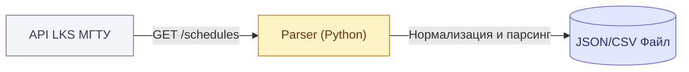

# 📅 ScheduleParser: Ядро данных расписания

**Скрипт для сбора, нормализации и сохранения расписания МГТУ им. Баумана (LKS) в удобный файл.**

## 🎯 Зачем это нужно

Сырые данные из API LKS сложны для обработки: в них нет прямых календарных дат, есть сложная структура факультетов, а информация об аудиториях приходит в специфичном формате. 

Скрипт решает три задачи:
1. 🐍 **Сбор данных:** забирает расписание через API LKS по UUID группы.
2. 📄 **Нормализация:** превращает сырые дни недели в реальные календарные даты, а UUID аудиторий — в понятные номера (например, "501").
3. 💾 **Сохранение:** выгружает готовые данные в локальный файл (JSON/CSV). Расписание меняется редко (раз в семестр), поэтому база данных избыточна.

> ⚡ **Этот скрипт — фундамент для будущих продуктов:**
> - 🚪 Поиск свободных аудиторий (где можно посидеть или провести мероприятие).
> - 🧮 Калькулятор нагрузки (поиск оптимального времени, чтобы пришло больше людей).

## 🏗 Архитектура и поток данных



## ⚙️ Как это работает (Механика парсинга)

1. **Получение структуры:** скрипт скачивает дерево факультетов и групп, чтобы найти UUID нужных групп.
2. **Запрос расписания:** идёт запрос на `schedules/groups/<uuid>/private`.
3. **Нормализация дат:** API отдаёт `day: 1` (понедельник) и `week: "all"`. Скрипт сам подставляет календарную дату, опираясь на `semesterStarts` и `weekNumber` из эндпоинта `/current`.
4. **Обработка нечетных/четных недель:** скрипт корректно раскладывает расписание для "числителя" и "знаменателя".
5. **Парсинг аудиторий:** если массив `audiences` пуст — значит, аудитория не назначена. Если есть — извлекаем номер и корпус.

## 📦 Формат вывода (JSON)

На выходе получаем чистый JSON-файл:

```json
[
  {
    "group_name": "СГН3-35Б",
    "date": "2026-10-19",
    "start_time": "10:15",
    "end_time": "11:50",
    "discipline": "Информатика",
    "lesson_type": "lab",
    "teachers": ["Хузин А.Ф."],
    "audience": "501",
    "week_type": "all" 
  }
]
```

## ❓ Открытые вопросы

1. **API LKS:** нужно проверить, отдаёт ли сервер информацию о занятости аудиторий в целом (или только для конкретной группы).
2. **Авторизация:** LKS может требовать токен или cookie для доступа к API. Нужно проверить через Postman/Insomnia.
