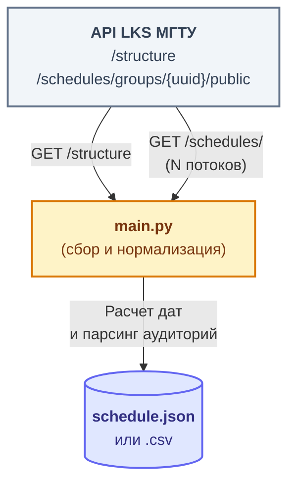

<p align="center">
  
</p>

<h1 align="center"> Парсер расписания </h1> 
<p align="center">
  Скрипт для сбора, нормализации и сохранения расписания МГТУ им. Баумана (LKS) в удобный файл.
</p>

<p align="center">
  
  
  
</p>

## О проекте

Сырые данные из API LKS сложны для обработки: в них нет прямых календарных дат, есть сложная структура факультетов, а информация об аудиториях приходит в специфичном формате.

Скрипт решает три задачи:

-  **Сбор данных:** параллельно забирает расписание через публичный API LKS.
-  **Нормализация:** превращает сырые дни недели в реальные календарные даты, а UUID аудиторий — в понятные номера.
-  **Сохранение:** выгружает готовые данные в JSON или CSV.

## Установка

```bash
python -m venv .venv
source .venv/bin/activate      # Windows: .venv\Scripts\activate
pip install -r requirements.txt
```

## Настройка

Все параметры — в `src/settings.py`. Отредактируйте файл перед запуском:

| Параметр | По умолчанию | Описание |
|---|---|---|
| `FILIAL` | `8c1b7... МГТУ им. Баумана` | UUID филиала (см. `/structure` в API LKS) |
| `START_DATE` | `2026-09-01` | Дата начала семестра, `YYYY-MM-DD` |
| `WEEKS` | `17` | Сколько недель разворачивать |
| `OUTPUT` | `schedule.json` | Выходной файл (`.json` или `.csv`) |
| `WORKERS` | `16` | Потоков параллельных запросов |
| `TIMEOUT` | `30` | Таймаут одного запроса, сек |
| `VERBOSE` | `False` | Подробные логи (уровень DEBUG) |

## Использование

После настройки `src/settings.py`:

```bash
python src/main.py
```

Пример вывода:

```text
Парсер расписания МГТУ им. Баумана
Филиал: 8c1b7bb8-…  |  Старт: 2026-09-01  |  недель: 17  |  потоков: 16
OK: найдено групп: 3005
Получение расписаний: 100%|████████████| 3005/3005 [00:46<00:00]
OK: получено расписаний: 1793
Нормализация: 100%|████████████████████| 1793/1793 [00:00<00:00]
OK: занятий: 456596
DONE: сохранено в schedule.json
```

## Стек технологий

**Backend:**

-  Python 3.12
-  JSON / CSV 

**Инструменты:**

-  Requests + `ThreadPoolExecutor` (параллельные запросы)
-  tqdm (прогресс-бары)

## Архитектура



## Механика парсинга

1. **Получение структуры.** `GET /structure` возвращает дерево университета: филиал, факультет, кафедра, курс, группа. Скрипт обходит пять уровней вложенности и собирает UUID всех групп нужного филиала.
2. **Запрос расписаний.** `GET /schedules/groups/<uuid>/public` выполняется **параллельно** через `ThreadPoolExecutor`.
3. **Нормализация дат.** API отдаёт `day: 1` (понедельник) и `week: "all" | "ch" | "zn"`. Скрипт вычисляет календарную дату от `START_DATE` и номера недели по формуле `(week_number - 1) * 7 + (day_of_week - isoweekday(START_DATE))`.
4. **Чётные и нечётные недели** (в пределах `WEEKS`, по умолчанию 17):
   - `ch` — числитель, недели 1, 3, 5, … ;
   - `zn` — знаменатель, недели 2, 4, 6, … ;
   - `all` — каждую неделю.
5. **Пропуск первой недели.** Если `START_DATE` попадает на середину недели, занятия «первой недели», выпадающие раньше этой даты, отбрасываются — в итоговом JSON нет дат раньше `START_DATE`.
6. **Парсинг аудиторий.** Если массив `audiences` пуст, аудитория не назначена; иначе берётся поле `name` каждой аудитории (например, `"501"`). Информация о корпусе в выходной файл не попадает.

## Пример формата вывода (JSON)

```json
[
  {
    "date": "2026-10-19",
    "group_name": "СГН3-35Б",
    "discipline": "Информатика",
    "start_time": "10:15",
    "end_time": "11:50",
    "teachers": ["Хузин А. Ф."],
    "audiences": ["501"],
    "lesson_type": "lab",
    "week_type": "all",
    "day_of_week": 1
  }
]
```
